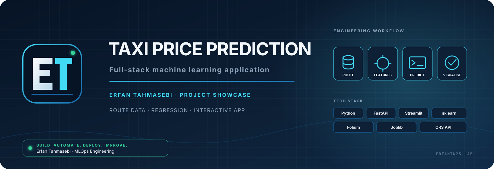

# Taxi Price Prediction — Full-Stack Machine Learning

<div align="center">



[](https://github.com/erfantk25-lab/taxi-prediction-fullstack-ERFAN/actions/workflows/ci.yml)
<div align="center">

  <a href="https://www.python.org/" title="Python"></a>
  <a href="https://fastapi.tiangolo.com/" title="FastAPI"></a>
  <a href="https://streamlit.io/" title="Streamlit"></a>
  <a href="https://scikit-learn.org/" title="scikit-learn"></a>
  <a href="https://github.com/features/actions" title="GitHub Actions"></a>
  <a href="https://pandas.pydata.org/" title="Pandas"></a>
  <a href="https://numpy.org/" title="NumPy"></a>
  <a href="https://python-visualization.github.io/folium/" title="Folium / Leaflet"></a>
  <a href="https://openrouteservice.org/" title="OpenRouteService"></a>

</div>

**Individual portfolio project · Machine Learning · API · Interactive application**

</div>

An individual portfolio project that combines a machine-learning regression model, a FastAPI prediction service, and a Streamlit interface. A user enters two addresses, the application retrieves a driving route, and the backend predicts a taxi fare using route distance, estimated duration, passenger count, and fare rates.

## Quick navigation

[Overview](#project-overview) · [Architecture](#architecture) · [Model](#model-training-and-evaluation) · [Setup](#setup) · [Run](#run-the-application) · [API](#api-reference) · [Engineering notes](#engineering-notes)

## Project overview

| Component | Responsibility |
|---|---|
| **Streamlit** | User interface and trip input |
| **OpenRouteService** | Geocoding and driving-route information |
| **FastAPI** | REST API for prediction and health checks |
| **scikit-learn** | Regression pipeline and fare prediction |
| **Folium** | Interactive route map |
| **Joblib / JSON** | Persisted model and training metadata |

## Architecture

<div align="center">

</div>

The frontend obtains route information and sends trip features to the API. FastAPI performs inference with the saved scikit-learn pipeline, then returns the predicted price to the Streamlit application. Folium displays the route.

The frontend and API run as separate processes. The frontend sends calculated trip features to the backend; the backend is responsible for model inference.

## Model training and evaluation

The training script is the reproducible source of truth:

```bash
python -m src.model_development.train_model
```

It reads `data/taxi_trip_clean.csv`, uses an 80/20 train/test split with `random_state=42`, evaluates Linear Regression, Decision Tree, and Random Forest models, and compares them using RMSE. Each candidate is wrapped in a pipeline containing a mean-value `SimpleImputer`. The best candidate is then retrained on the complete dataset.

The script exports:

- `src/model_development/taxi_price_model.pkl` — fitted preprocessing and regression pipeline loaded by the API.
- `src/model_development/model_metadata.json` — selected model, feature names, candidate RMSE scores, training row count, and scikit-learn version.

The notebook `testing_models.ipynb` documents the original experiments. Its previously recorded test RMSE values were:

| Model | Recorded RMSE |
|---|---:|
| Linear Regression | 16.9534 |
| Decision Tree | 19.1344 |
| Random Forest | 11.3966 |

These are historical notebook results, not a claim that the current training script has been executed in every environment. Run the training script to generate fresh scores and metadata.

## Tech stack

- Python 3.13
- FastAPI and Uvicorn
- Streamlit
- Pandas and NumPy
- scikit-learn
- Joblib
- Folium and Streamlit-Folium
- OpenRouteService
- Requests

## Repository structure

```text
.
├── data/
│   └── taxi_trip_clean.csv
├── src/
│   ├── backend/
│   │   └── api.py
│   ├── frontend/
│   │   └── dashboard.py
│   └── model_development/
│       ├── testing_models.ipynb
│       ├── train_model.py
│       ├── taxi_price_model.pkl
│       └── model_metadata.json
├── screenshots/
├── .streamlit/
│   └── secrets.toml.example
├── requirements.txt
└── README.md
```

Model files are generated by the training script. If they are not present in a fresh clone, run the training step before starting the API.

## Setup

Python 3.13 is recommended to match the notebook environment.

```bash
git clone https://github.com/erfantk25-lab/taxi-prediction-fullstack-ERFAN.git
cd taxi-prediction-fullstack-ERFAN

python -m venv .venv
```

Activate the environment:

**Windows PowerShell**
```powershell
.venv\Scripts\Activate.ps1
```

**macOS / Linux**
```bash
source .venv/bin/activate
```

Install dependencies and train/export the model:

```bash
python -m pip install --upgrade pip
pip install -r requirements.txt
python -m src.model_development.train_model
```

## OpenRouteService API key

Create a file named `.streamlit/secrets.toml`:

```toml
ORS_API_KEY = "YOUR_OPENROUTESERVICE_API_KEY"
```

Get an API key from [OpenRouteService](https://openrouteservice.org/). The real `secrets.toml` file is excluded by `.gitignore`; never commit API keys.

## Automated checks

GitHub Actions runs model training and API smoke tests on pushes and pull requests. Run the same checks locally:

```bash
python -m pip install -r requirements.txt
python -m src.model_development.train_model
python -m pytest -q
```

The frontend API address can be overridden with the `TAXI_API_URL` environment variable. The default is `http://127.0.0.1:8000/predict`.

## Run the application

Start the backend in terminal 1:

```bash
uvicorn src.backend.api:app --reload
```

Start the frontend in terminal 2:

```bash
streamlit run src/frontend/dashboard.py
```

Open the Streamlit URL printed in the terminal (normally http://localhost:8501).

### Verify the backend without the frontend

You can test the API independently of Streamlit. With the backend running, check that both the model and dataset loaded:

```bash
curl http://127.0.0.1:8000/health
```

A ready service returns `"status": "ok"`, `"model_loaded": true`, and `"dataset_loaded": true`. If the model is unavailable, the API reports a degraded state; run the training command from the Setup section and restart the backend.

Send a test prediction:

```bash
curl -X POST http://127.0.0.1:8000/predict \
  -H "Content-Type: application/json" \
  -d '{
    "Trip_Distance_km": 10.5,
    "Passenger_Count": 1,
    "Base_Fare": 50.0,
    "Per_Km_Rate": 18.0,
    "Per_Minute_Rate": 7.0,
    "Trip_Duration_Minutes": 15.0
  }'
```

The response contains a `predicted_price` value. The exact result depends on the model artifact generated from the training data.

Interactive API documentation is available at http://127.0.0.1:8000/docs. The API health endpoint is http://127.0.0.1:8000/health.

## API reference

| Method | Endpoint | Purpose |
|---|---|---|
| GET | `/` | API welcome message |
| GET | `/health` | Model and dataset readiness |
| GET | `/data/head?n=10` | First rows of the cleaned dataset |
| GET | `/data/trip/{trip_id}` | Retrieve a row by DataFrame index |
| POST | `/predict` | Predict a trip price |

Example request body:

```json
{
  "Trip_Distance_km": 10.5,
  "Passenger_Count": 1,
  "Base_Fare": 50.0,
  "Per_Km_Rate": 18.0,
  "Per_Minute_Rate": 7.0,
  "Trip_Duration_Minutes": 15.0
}
```

The response contains a `predicted_price` value in SEK. The request below can be sent directly to the local API after model training and backend startup:

```bash
curl -X POST http://127.0.0.1:8000/predict \
  -H "Content-Type: application/json" \
  -d '{
    "Trip_Distance_km": 10.5,
    "Passenger_Count": 1,
    "Base_Fare": 50.0,
    "Per_Km_Rate": 18.0,
    "Per_Minute_Rate": 7.0,
    "Trip_Duration_Minutes": 15.0
  }'
```

## Screenshots

Screenshots from the running application and API documentation are available in the `screenshots/` directory.

## Engineering notes

- Training and inference use the same ordered feature list.
- Preprocessing is packaged with the estimator in one scikit-learn pipeline.
- The API checks the model's feature names and turns model-load failures into a clear degraded health state.
- The training script writes model metadata so the artifact can be traced to its training configuration.
- Joblib model files are pickle-based. Only load model artifacts from a trusted source, and keep training and serving dependency versions aligned.

## Project type

**Individual project** — designed and implemented as a full-stack machine-learning portfolio project.

---

<div align="center">

[← Back to my GitHub profile](https://github.com/erfantk25-lab) · [Portfolio](https://erfantk25-lab.github.io/)

</div>
