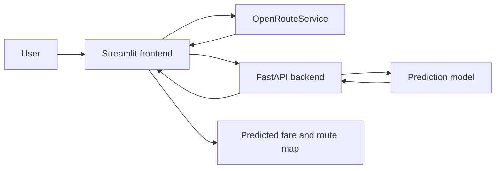

# Architecture

The diagram reflects the separation between the Streamlit user interface, FastAPI backend, ML prediction and route lookup described in the project README.

## Components

- **Streamlit:** collects trip input and presents the result.
- **OpenRouteService:** supplies route information used by the application.
- **FastAPI:** exposes the prediction API independently of the frontend.
- **ML model:** estimates the fare from the trip information.

## Local development

Run the backend and frontend as separate processes, following the commands and dependency setup in the repository's root README.

## Next documentation improvements

- Add a reproducible environment setup and sample environment file.
- Document the exact request and response schema for each endpoint.
- Add tests for invalid inputs, unavailable routing service and model-loading errors.
- Record the dataset, evaluation split and model metrics used for the displayed prediction.
